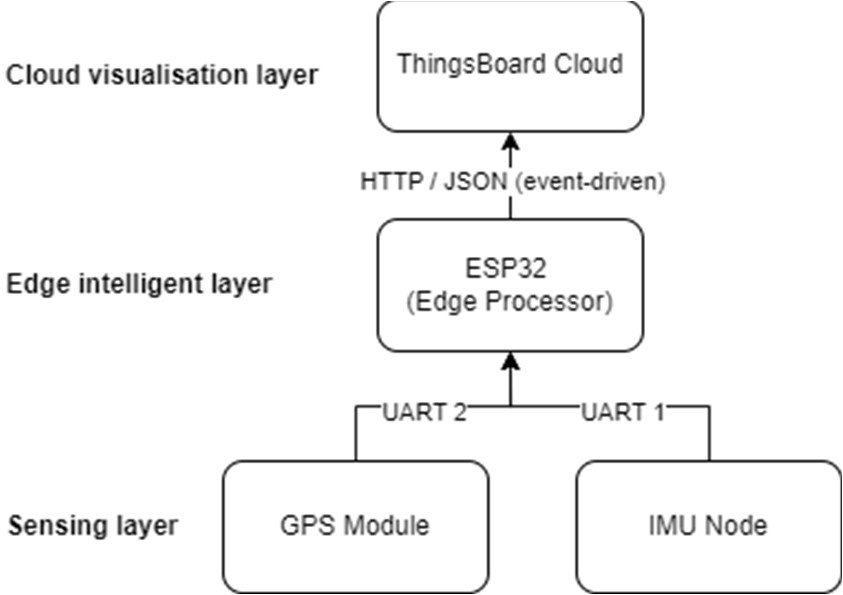
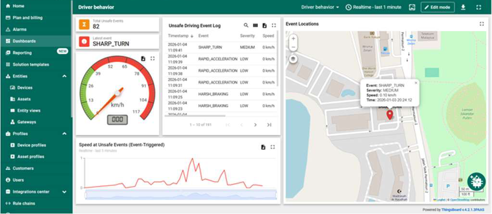

# Smart Transportation Tracking System

**Edge-Based Event Detection & Selective Cloud Communication**

**Course:** Embedded System Development (CSC4700-1), Universiti Putra Malaysia
**Assignment:** 2 (Group 4)
**Lecturer:** Ts. Dr. Raihani Bt Mohamed
**Keywords:** Edge computing, ESP32, driver behavior, event-driven telemetry, ThingsBoard

---

## 1. Project Overview

This project is a **smart transportation monitoring system** that detects unsafe driving behavior **directly at the edge** instead of streaming all sensor data to the cloud.

The system:

* Runs **sensor fusion and event detection locally** on an ESP32
* Gives the driver an **immediate local alert** (LED strip and buzzer)
* Uploads **only validated unsafe driving events** to a ThingsBoard dashboard

Keeping the decision logic at the edge reduces latency, network use and energy use, and the detection does not depend on the cloud being reachable.

**Reports:** the full write-ups are in [`docs/`](docs/):

* [`CSC4700 Assignment 2 Report.pdf`](docs/CSC4700%20Assignment%202%20Report.pdf): the design report (IoT design methodology, 23 pages)
* [`CSC4700 Assignment 2 Report (IEEE).pdf`](docs/CSC4700%20Assignment%202%20Report%20(IEEE).pdf): the IEEE-style paper with the experiments and results (10 pages)

---

## 2. System Architecture



### 2.1 Sensing layer

* **GPS module (GY-NEO6MV2):** latitude, longitude, speed, heading and UTC time
* **IMU (Arduino Nano 33 BLE Rev2):** streams raw accelerometer (g) and gyroscope (deg/s) readings at 50 Hz over UART. The Nano does no filtering or decision-making.

### 2.2 Edge intelligence layer (ESP32)

* Madgwick sensor fusion for roll, pitch and yaw
* Gravity-compensated linear acceleration, jerk and yaw rate
* State-machine gating (IDLE / ARMED) to ignore noise
* Event detection and severity classification
* Local visual and audible alerts

### 2.3 Cloud visualization layer

* **ThingsBoard Cloud** dashboard that receives event-driven telemetry only: event type, severity, speed, GPS position and timestamps.



---

## 3. Hardware

| Component                   | Role                              | Cost (RM) |
| --------------------------- | --------------------------------- | --------- |
| ESP32 Dev Module            | Edge processor and decision logic | 32.40     |
| Arduino Nano 33 BLE Rev2    | Raw IMU sensing                   | 118.80    |
| GY-NEO6MV2 GPS              | Position, speed, UTC time         | 21.50     |
| NeoPixel LED strip (8 LEDs) | Visual alerts                     | 8.90      |
| Piezo buzzer with wires     | Audible alerts                    | 1.50      |

Costs are from the IEEE report (about RM 183 in total). The wiring diagram is Fig. 7 of that report.

### Wiring (pins as defined in `edge_esp32.ino`)

| Connection                                    | ESP32 pin |
| --------------------------------------------- | --------- |
| GPS TX → ESP32 RX (`GPS_RX`)                  | GPIO 16   |
| GPS RX ← ESP32 TX (`GPS_TX`, optional)        | GPIO 17   |
| Nano TX (`Serial1`, D1) → ESP32 RX (`IMU_RX`) | GPIO 27   |
| Nano RX ← ESP32 TX (`IMU_TX`, optional)       | GPIO 26   |
| NeoPixel data (`NEOPIXEL_PIN`)                | GPIO 4    |
| Buzzer (`BUZZER_PIN`)                         | GPIO 25   |

Connect the grounds of the ESP32, the Nano and the GPS module together. The Nano 33 BLE and the ESP32 both use 3.3 V logic.

---

## 4. Edge Processing Pipeline

### 4.1 Sensor fusion and features

* The Madgwick filter fuses accelerometer and gyroscope data into roll, pitch and yaw.
* Gravity is estimated from roll and pitch and subtracted to give **linear acceleration** (`ax_lin`).
* **Jerk** is the change in acceleration magnitude between samples; **yaw rate** is the gyroscope z-axis (`gz`).

### 4.2 State machine gating (IDLE ↔ ARMED)

* IDLE → ARMED when the acceleration magnitude deviates from 1 g by more than 0.18 g, or jerk exceeds 0.12 g.
* ARMED → IDLE when the deviation stays below 0.10 g for 1.2 s and the system has been armed for at least 0.8 s.
* Events are only detected while ARMED, which prevents noise-induced false detections.

---

## 5. Unsafe Driving Event Detection

Thresholds are prototype defaults in `edge_esp32.ino` and depend on how the IMU is mounted.

| Event              | Rule                                                                    |
| ------------------ | ----------------------------------------------------------------------- |
| Collision          | \|A\| > 2.10 g and jerk > 0.45 g on 2 consecutive checks (always High)  |
| Harsh braking      | `ax_lin` < −0.55 g                                                      |
| Rapid acceleration | `ax_lin` > +0.55 g                                                      |
| Sharp turn         | \|`gz`\| > 160 deg/s                                                    |

* Collision has the highest priority. A 500 ms cooldown separates events.
* **GPS validation:** a collision is **rejected** when a GPS fix reports a speed below 2 km/h (`STATIONARY_GPS`). The other event types are not filtered by GPS speed.
* Rejected events are printed on the serial monitor with the reason but are not alerted or uploaded.
* The firmware implements these four event types. The design report also lists overspeeding among the intended events; it is not in this firmware.

### Severity

Braking, acceleration and turn events are graded by how far the value exceeds its threshold: **Low** below 1.5×, **Medium** from 1.5×, **High** from 2×. Collisions are always High. Severity controls the local alert intensity and is sent to the cloud with every uploaded event.

---

## 6. Local Alerting

Alerts fire immediately at the edge, before any upload is attempted:

| Severity | NeoPixel                          | Buzzer                          |
| -------- | --------------------------------- | ------------------------------- |
| Low      | LEDs 0–2 solid green for 0.8 s    | none                            |
| Medium   | LEDs 0–5 solid yellow for 1.5 s   | one short beep                  |
| High     | all 8 LEDs blinking red for 2.5 s | repeated beeps with the blinks  |

---

## 7. Cloud Communication

* An HTTPS POST of JSON to the ThingsBoard Cloud telemetry endpoint, using the device access token. It is sent **only when a validated unsafe event occurs**, with up to 3 attempts.
* Payload fields: `ts` (GPS UTC time in epoch ms), `event_type`, `severity`, `gps_ts_ms`, `upload_ts_ms`, `speed`, `latitude`, `longitude`.
* The dashboard is for post-event analysis (event log, severity, speed, map), not for real-time control.

---

## 8. Performance Evaluation Summary

Measured in our bench tests, where hand-gesture excitation deliberately produced frequent events (a stress case). The full method and tables are in the [IEEE report](docs/CSC4700%20Assignment%202%20Report%20(IEEE).pdf).

* **Latency (event detected → stored in ThingsBoard):** about 180 valid events gave a minimum of about 1.0 s, a median of about 1.2 s, a mean of about 1.3 s and a maximum of about 2.0 s. Delay is dominated by network communication, not edge computation.
* **Energy efficiency:** the Wi-Fi transmit duty cycle was 5.1 %, 17.6 % and 12.4 % over three 60 s windows (below 18 % throughout). At about 5 events per minute this is roughly 12.4 %, an estimated 88 % reduction against 1 Hz continuous telemetry.
* **Reliability:** state-machine gating and the cooldown prevented event flooding under noisy input, collision candidates at under 2 km/h were rejected, local alerts kept working with Wi-Fi disconnected, and no crash was observed in prolonged operation.

---

## 9. Repository Structure

```
├── edge_esp32/
│   └── edge_esp32.ino              # ESP32: fusion, detection, alerts, ThingsBoard upload
├── nano_raw_imu_sender/
│   └── nano_raw_imu_sender.ino     # Nano 33 BLE: raw IMU stream over UART
├── docs/
│   ├── CSC4700 Assignment 2 Report.pdf
│   ├── CSC4700 Assignment 2 Report (IEEE).pdf
│   └── images/                     # figures used in this README
├── LICENSE
└── README.md
```

Each sketch is in its own folder because the Arduino IDE treats every `.ino` file in a folder as one sketch.

---

## 10. Setup

**Libraries** (Arduino Library Manager):

* ESP32 sketch: *TinyGPSPlus*, *Madgwick* (`MadgwickAHRS.h`), *Adafruit NeoPixel*, plus the ESP32 board package (provides `WiFi` and `HTTPClient`)
* Nano sketch: *Arduino_BMI270_BMM150*, plus the Arduino Mbed OS Nano boards package

Both sketches compile with `arduino-cli` (ESP32 board package 3.3.5 for **ESP32 Dev Module**, and Arduino Mbed OS Nano boards 4.4.1 for the **Nano 33 BLE**).

**Steps:**

1. Wire the hardware as in section 3.
2. Upload `nano_raw_imu_sender/nano_raw_imu_sender.ino` to the Nano 33 BLE.
3. In `edge_esp32/edge_esp32.ino`, fill in `WIFI_SSID`, `WIFI_PASS` and `TB_DEVICE_TOKEN` (a ThingsBoard Cloud device access token). **Do not commit these values.**
4. Upload `edge_esp32/edge_esp32.ino` to the ESP32 board (ESP32 Dev Module).
5. Open the serial monitor at **115200 baud** to see the 5 Hz status line, `EDGE_EVENT_JSON` lines for each detected event, and the energy statistics.

---

## 11. Limitations & Future Work

* Thresholds are fixed and need manual tuning for each mounting position.
* Uploads and Wi-Fi reconnection are blocking: while an HTTP request or a reconnect attempt (up to about 3 s) is in progress, IMU processing and the blinking pattern pause. Detection and the first alert do not depend on the cloud.
* Without a GPS fix the telemetry timestamp `ts` is 0, and the upload timestamp is 0 until NTP time has synced. The latency analysis therefore excluded events recorded before GPS lock.
* Only collisions are checked against GPS speed.
* Results come from bench tests with hand-gesture excitation, not from road driving.
* Possible improvements: adaptive thresholds, non-blocking or MQTT communication, offline buffering, learning-based behavior models, CAN bus integration.

---

## 12. Conclusion

Detecting unsafe driving at the edge is a practical approach for transportation safety monitoring. Moving the intelligence next to the sensors gives low latency, low network energy use and alerts that work even when the connection is poor.

---

## 13. Team (Group 4)

Adibah Nawal Binti Muhammad Lukman, Filzah Irdina Binti Ramdan, Nurul Izzah Mardhiyyah Binti Mahmud, Sharifah Hana Maisarah Binti Syed Omar, Fatin Nurmaryam Binti Khairul Arifin and Nur Farzana Alya Binti Saharudin.

## 14. Licence

[MIT](LICENSE)
